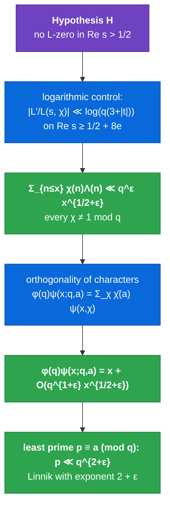

<div align="center">

# 🧮 primes-in-progressions-grh

### Primes in arithmetic progressions and the least prime in a progression under the generalized Riemann hypothesis

[](lean-toolchain)
[](lake-manifest.json)
[](axioms.txt)
[-d73a49)](LiouvilleEnergyRH/Hypothesis.lean)
[](Axioms.lean)
[](PrimesInProgressions.lean)
[](https://github.com/anaxia-research/liouville-energy-rh)

</div>

---

> **Paper.** D. Bhattacharjee and U. Bhattacharya, *The Riemann Hypothesis and Its Generalization as One Energy Bound*, preprint, 2026.
>
> **Parent repository.** [anaxia-research/liouville-energy-rh](https://github.com/anaxia-research/liouville-energy-rh), the full Lean formalization of the paper.



🟣 **Parent conjecture:** the generalized Riemann hypothesis for Dirichlet L-functions, in the form of Hypothesis H: no Dirichlet L-function vanishes in Re s > 1/2.

🎯 **Statement.** For every ε > 0, uniformly in q ≥ 1 and a coprime to q:

- Σ_{n≤x} χ(n)Λ(n) = O(q^ε x^{1/2+ε}) for every non-principal character χ mod q;
- φ(q) ψ(x; q, a) = x + O(q^{1+ε} x^{1/2+ε}), where ψ(x; q, a) = Σ_{n≤x, n≡a (q)} Λ(n);
- the least prime p ≡ a (mod q) satisfies p ≤ C(ε) q^{2+ε} (the GRH form of Linnik's theorem).

✅ **Lean 4 declarations:**

| Declaration | Statement |
|---|---|
| `LiouvilleEnergyRH.Progressions.chi_psi_bound` | H ⟹ ‖Σ_{n≤x} χ(n)Λ(n)‖ ≤ K q^η x^{1/2+η} for χ ≠ 1 |
| `LiouvilleEnergyRH.Progressions.psiAP_bound` | H ⟹ \|φ(q)ψ(x;q,a) − x\| ≤ K q^{1+η} x^{1/2+η} |
| `LiouvilleEnergyRH.Progressions.least_prime_in_AP` | H ⟹ a prime p ≡ a (mod q) with p ≤ C q^{2+δ} |
| `LiouvilleEnergyRH.chi_psi_of_H` | top-level form of `chi_psi_bound` |
| `LiouvilleEnergyRH.psiAP_of_H` | top-level form of `psiAP_bound` |
| `LiouvilleEnergyRH.least_prime_of_H` | top-level form of `least_prime_in_AP` |

`lake env lean Axioms.lean` prints only `propext`, `Classical.choice` and `Quot.sound` for each (see `axioms.txt`). There is no `sorry`, `axiom` or `native_decide` in the sources. The von Mangoldt function is Mathlib's `ArithmeticFunction.vonMangoldt` and the characters are Mathlib's `DirichletCharacter`.

## 🔧 Build

```
lake exe cache get
lake build
lake env lean Axioms.lean
```

Lean v4.34.1, Mathlib v4.34.1.

## 🙏 Context and credit

This is one corollary of the paper *The Riemann Hypothesis and Its Generalization as One Energy Bound* by D. Bhattacharjee and U. Bhattacharya. The full formalization is at [anaxia-research/liouville-energy-rh](https://github.com/anaxia-research/liouville-energy-rh); the contour argument and the bound for ψ(x) are shared with [anaxia-research/prime-counting-rh](https://github.com/anaxia-research/prime-counting-rh). Hypothesis H is stated word for word as `DirichletLNonvanishingRightOfHalf` in L. Alpöge's Lean project (alpo.ge, November 2026). Third-party sources are listed in [`NOTICE`](NOTICE): the library `Vinogradov/` (creelie/breakthrough-problems-3, Apache 2.0), OpenAI's `LogarithmicControl.lean` (Apache 2.0), and the Selberg sieve from PrimeNumberTheoremAnd (Apache 2.0).

## 📖 Citation

```bibtex
@misc{primes-in-progressions-grh,
  author = {Bhattacharjee, Deep and Bhattacharya, Ushashi},
  title  = {primes-in-progressions-grh: primes in arithmetic progressions and the least prime in a progression under GRH, in Lean 4},
  year   = {2026},
  url    = {https://github.com/anaxia-research/primes-in-progressions-grh}
}
```
